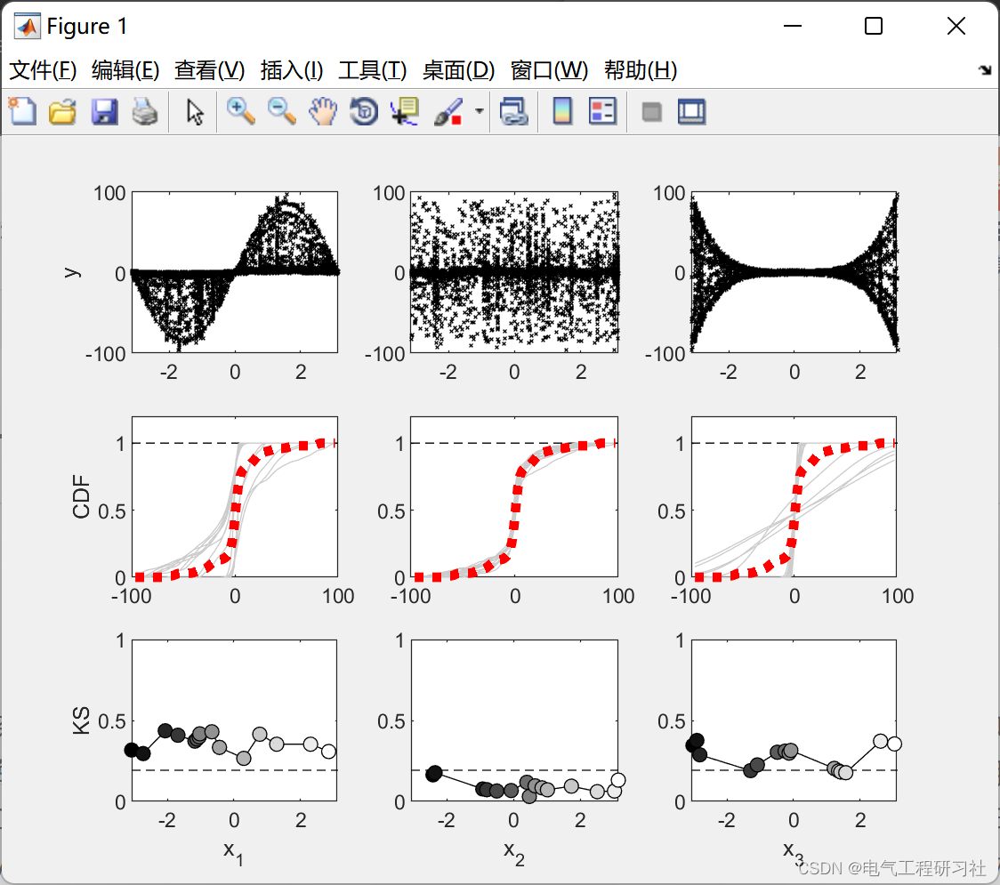
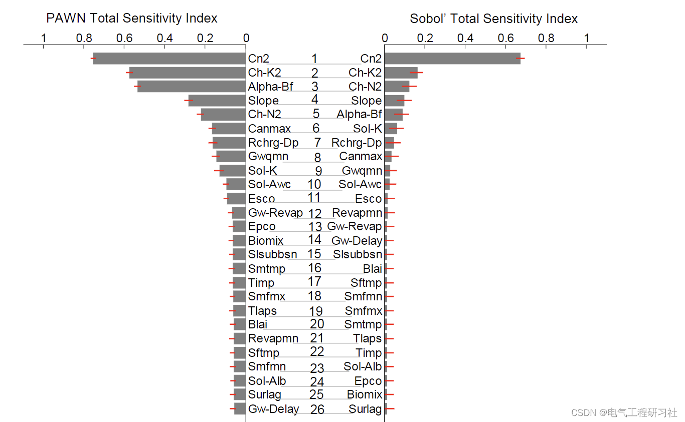
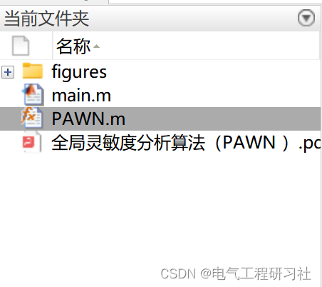

# Optimization Algorithm - Global Sensitivity Analysis Algorithm (PAWN) (Matlab Code Implementation)

1. Overview
The issue of numerous parameters in complex environmental modeling is primarily due to their limitations in application. Therefore, the sensitivity analysis (SA) method aimed at identifying influential and uninfluential parameters is crucial for the effective calibration of these models. SA indeed allows for the reduction of the number of parameters involved during the calibration process by applying factor fixing (FF) and factor prioritization (FP). In this paper, the Density-based Global Sensitivity Analysis (GSA) method -PAWN- is applied to the Soil and Water Assessment Tool (SWAT), a highly parameterized hydrological simulation tool. The aim of this study is to compare the newly developed PAWN method with the Sobol method, which is a mature and widely used variance-based SA method. The PAWN method considers the entire model output distribution to describe the uncertainty in output, while the Sobol method implicitly assumes that variance is a sufficient indicator for this purpose. To this end, using both PAWN and Sobol' methods, 26 water-related parameters from the Belgium Zenne River SWAT model were selected for ranking. Furthermore, the two SA methods were evaluated and compared in terms of convergence, the evolution of the ranking results, and the required computational cost.
2. Comparative Study of PAWN and Sobol Sensitivity Analysis Methods for High-Parameter Models Based on SWAT
3. Matlab Code and Article Explanation
This article only showcases part of the code; all codes are available in:
subplot(331); ylabel('y'); hold on;box on;\nsubplot(334); ylabel('CDF'); hold on;  box on;\nsubplot(337); ylabel('KS'); hold on; xlabel('x_1'); box on;\nsubplot(338); xlabel('x_2'); hold on;box on;\nsubplot(339); xlabel('x_3'); hold on;box on;\nfor ind=1:length(lb)\n    subplot(330+ind)\n    plot(par_c(:,ind),y_c, 'xk', 'markersize', 2);\nend\n\ncrit_c = [1.22,1.36,1.48,1.63,1.73,1.95]; % 0.1, 0.05, 0.025, 0.010, 0.005, 0.001\ncritval = crit_c(2) * sqrt((Nu+Nc)/(Nu*Nc));\n\nfor ind=1:length(lb)\n    subplot(333+ind)\n    plot([-100, 100], [1, 1], 'k--'); hold on\n    plot(ci,ft((ind-1)*n+1:ind*n,:), 'color', [0.8,0.8,0.8]); ylim([0,1]);\n    plot(ci,f, 'r:','linewidth',4); ylim([0,1.2])\n    hold off\nend\n\ncolData = linspace(0,n,n)'/n; colData = [colData colData colData];\n\nfor ind=1:length(lb)\n    subplot(336+ind)\n    [xtoplot, indices] = sort(xvals(ind,:));\n    ytoplot = KS(ind, :); ytoplot = ytoplot(indices);\n    plot([min(xvals(:)), max(xvals(:))], [critval,critval], 'k--'); hold on;\n    plot(xtoplot, ytoplot, 'k');\n    scatter(xtoplot, ytoplot, [],  colData, 'filled', 'markeredgecolor', 'k'); \n    ylim([0,1])\n    hold off\nend\n  
​  

## Images

<!-- PAYMENT_BLOCK -->

## Get this dataset

- Payment link (Stripe): [Buy now](https://buy.stripe.com/3cs8yP7sY87d0vu9AB)
- Payment QR code: 

<!-- /PAYMENT_BLOCK -->
